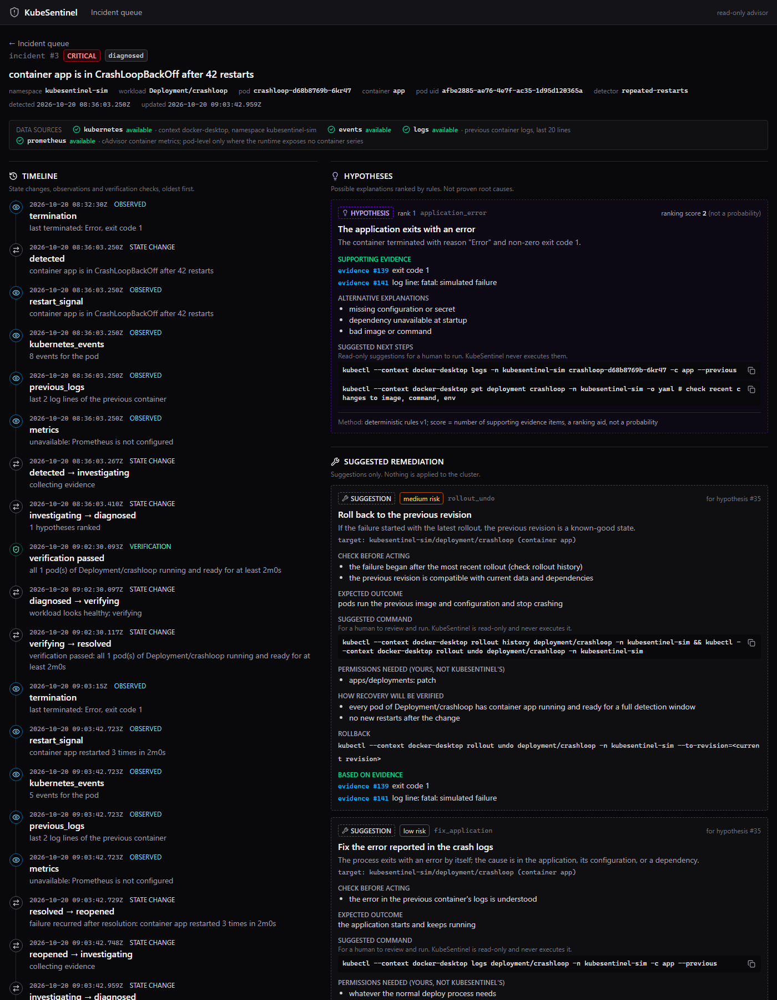
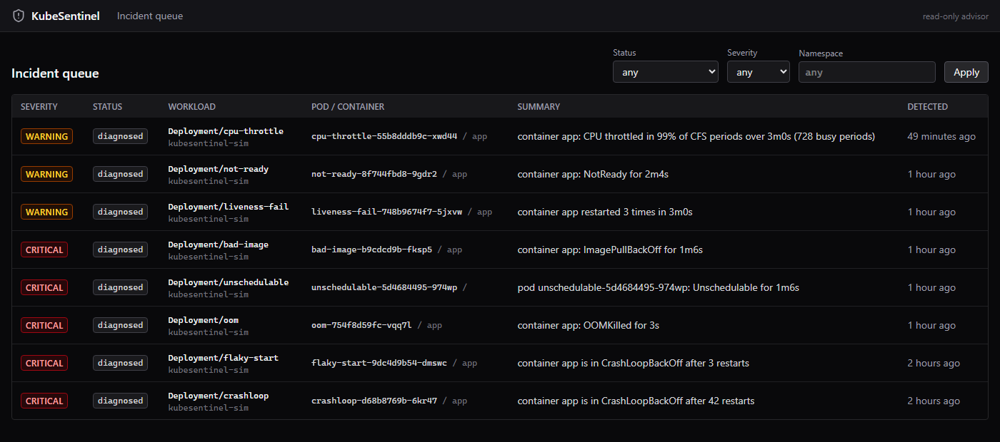
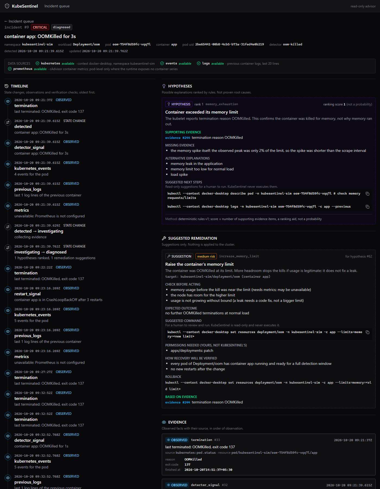
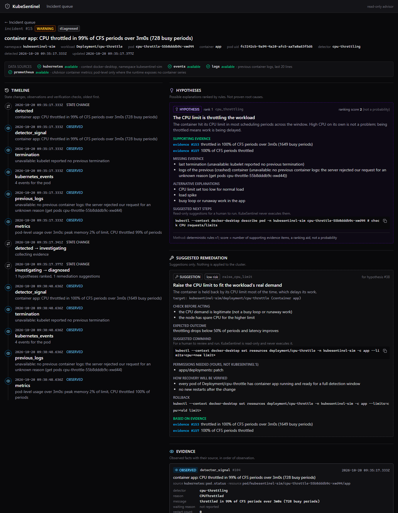

<p align="center">
  
</p>
<h2 align="center">KubeSentinel</h2>
<p align="center">
  <b>Kubernetes incident investigation and remediation advisor</b><br/>
  Detects failures · explains them with evidence · suggests safe fixes · verifies recovery
</p>
<p align="center">
  <a href="https://hub.docker.com/r/sinhasandeep2006/kubesentinel-server">Docker Hub</a>
</p>

<details>
  <summary>Table of Contents</summary>

  1. [Working Demo](#working-demo)
  2. [About The Project](#about-the-project)
     - [How It Works](#how-it-works)
     - [Built With](#built-with)
  3. [Getting Started](#getting-started)
     - [Prerequisites](#prerequisites)
     - [Installation](#installation)
     - [Docker Images](#docker-images)
  4. [Usage](#-usage)
  5. [Roadmap](#roadmap)
  6. [Contact](#contact)

</details>

### Working Demo

<p align="center">
  <u><h4>Incident Queue</h4></u>
  
</p>
<p align="center">
  <u><h4>Investigations: out of memory and CPU throttling</h4></u>
  
  
</p>

> Runs locally against Docker Desktop Kubernetes. See [Getting Started](#getting-started) to run the full demo with 8 built-in failure scenarios.

### <u>About The Project</u>

**KubeSentinel** is a ***Kubernetes incident investigation workbench*** built with ***Go, PostgreSQL, Prometheus and React***. It answers one question:

> **What happened, what evidence explains it, and what should we do next?**

When a pod breaks, an engineer normally runs `kubectl describe`, reads events, pulls the crashed container's logs and checks memory graphs, then pieces it together by hand. KubeSentinel does that investigation automatically and ***shows its reasoning***.

- It ***detects*** failures: repeated restarts, CrashLoopBackOff, OOMKilled, image pull errors, unschedulable pods, failing probes, CPU throttling.

- It ***collects evidence***: exit codes, termination reasons, Kubernetes events, crashed-container logs (secrets redacted), and Prometheus CPU and memory.

- It ***diagnoses*** with ranked hypotheses, each listing ***supporting, contradicting and missing evidence***.

- It ***suggests fixes*** with a command, risk level, preconditions and rollback plan, ***for a human to run***. It never changes the cluster.

- It ***verifies recovery***: an incident is resolved only after the workload stays healthy for a full window, checked against the live cluster.

- It ***never shows missing data as zero***. If a source is down, the incident says so.

#### How It Works

```text
Kubernetes API ─┐
                ├─► Detectors ─► Incident manager ─► Evidence collector ─► Diagnosis ─► Fix suggestions
Prometheus ─────┘                       │                                                      │
                                        └──────────── PostgreSQL ◄─────────────────────────────┘
                                                          │
                                                   REST API ─► React UI ─► Engineer
                                                          │
                       every 30s: verifier re-reads live pods ─► resolved, or stays open
```

| Step | What happens |
|------|--------------|
| 1. Detect | A rule notices a failure pattern and emits a signal |
| 2. Collect | Evidence is gathered; any source that fails is recorded as *unavailable*, never dropped |
| 3. Diagnose | Deterministic rules rank hypotheses. Scores are ranking aids, ***not probabilities*** |
| 4. Suggest | Each hypothesis with a safe remedy gets a fix proposal (suggestion-only, enforced by the database) |
| 5. Verify | The incident resolves only after every pod stays running and ready for a full window |

#### Built With

<table>
  <tr>
    <th colspan="3" align="center"><u>Backend</u></th>
  </tr>
  <tr>
    <td><a href="https://go.dev/"></a></td>
    <td><a href="https://github.com/kubernetes/client-go"></a></td>
    <td><a href="https://github.com/jackc/pgx"></a></td>
  </tr>

  <tr>
    <th colspan="3" align="center"><u>Infrastructure & Data</u></th>
  </tr>
  <tr>
    <td><a href="https://kubernetes.io/"></a></td>
    <td><a href="https://www.postgresql.org/"></a></td>
    <td><a href="https://prometheus.io/"></a></td>
  </tr>
  <tr>
    <td><a href="https://www.docker.com/"></a></td>
    <td><a href="https://nginx.org/"></a></td>
    <td><a href="https://www.docker.com/products/docker-desktop/"></a></td>
  </tr>

  <tr>
    <th colspan="3" align="center"><u>Frontend</u></th>
  </tr>
  <tr>
    <td><a href="https://react.dev/"></a></td>
    <td><a href="https://www.typescriptlang.org/"></a></td>
    <td><a href="https://vitejs.dev/"></a></td>
  </tr>
  <tr>
    <td><a href="https://tailwindcss.com/"></a></td>
    <td><a href="https://tanstack.com/query"></a></td>
    <td><a href="https://reactrouter.com/"></a></td>
  </tr>

  <tr>
    <th colspan="3" align="center"><u>Version Control</u></th>
  </tr>
  <tr>
    <td align="center" colspan="3"><a href="https://git-scm.com/"></a></td>
  </tr>
</table>

### Getting Started
To get a local copy up and running, follow these steps.

#### **Prerequisites**
Make sure you have the following installed:
- **Docker Desktop** with **Kubernetes enabled** (Settings → Kubernetes → Enable)
- **Go** 1.27 or above
- **Node.js** 20 or above (npm comes with it)
- **kubectl**

#### **Installation**
1. Clone the repo
```bash
  git clone https://github.com/sinhasandeep2006/kubesentinel.git
```
2. Move to the project folder
```bash
  cd kubesentinel
```
3. Start the database (Postgres in Docker)
```bash
  docker compose -f deployments/docker/compose.yml up -d --wait
```
4. Start Prometheus and the 8 failure simulations
```bash
  kubectl --context docker-desktop apply -f deployments/kubernetes/monitoring/
  kubectl --context docker-desktop apply -f deployments/kubernetes/sim/
```
5. Start the backend <small>(3-minute window for a quick demo)</small>
```powershell
  $env:KS_PROMETHEUS_URL="http://localhost:30090"; $env:KS_RESTART_WINDOW="3m"; go run ./cmd/server
```
6. Start the frontend <small>(new terminal)</small>
```bash
  cd frontend
  npm install
  npm run dev
```
7. Open **http://localhost:5173**. Incidents appear within 2–3 minutes.

> ℹ️ **Note:** With `make` installed (`winget install ezwinports.make`), steps 3–6 are `make db-up`, `make monitoring-up`, `make sim-up`, `make run` and `make frontend-dev`.

#### **Docker Images**
```bash
  docker pull sinhasandeep2006/kubesentinel-server:0.1.0
  docker pull sinhasandeep2006/kubesentinel-ui:0.1.0
```
Or build them yourself:
```bash
  docker build -t kubesentinel-server:dev .
  docker build -t kubesentinel-ui:dev frontend
  docker run -p 8081:80 -e KS_API_URL=http://host.docker.internal:8080 kubesentinel-ui:dev
```
> ℹ️ **Note:** The server image needs `KS_DATABASE_URL` and Kubernetes access. In-cluster deployment with a read-only service account is in progress.

## 📋 Usage

Here's how to use **KubeSentinel** after setting it up:

<h4>🗂️ Pages</h4>

| Page | Route | What it shows |
|------|-------|---------------|
| 📋 Incident Queue | `/` | Every incident, filterable by status, severity and namespace |
| 🔍 Investigation | `/incidents/:id` | Timeline, evidence, hypotheses, fix suggestions, verification |

<h4>🧪 Built-in Failure Scenarios</h4>

| Test App | Failure | Diagnosis |
|----------|---------|-----------|
| `crashloop` | Exits with code 1 | application error |
| `flaky-start` | Fails 4 times, then recovers | application error → **resolved** |
| `oom` | Grows past its memory limit | out of memory |
| `bad-image` | Image tag does not exist | image not found |
| `unschedulable` | Requests 4Ti of memory | not enough resources on any node |
| `not-ready` | Readiness probe always fails | readiness probe failure |
| `liveness-fail` | Liveness probe always fails | liveness probe failure |
| `cpu-throttle` | Busy loop under a tiny CPU limit | CPU throttling |

> ℹ️ **Note:** Test apps run only in the `kubesentinel-sim` namespace. Clean up with `kubectl --context docker-desktop delete namespace kubesentinel-sim kubesentinel-monitoring` and `docker compose -f deployments/docker/compose.yml down`.

---

### ✅ **1. Investigate an Incident**
- Open any incident from the queue.
- **Evidence** (solid boxes) are observed facts with their source.
- **Hypotheses** (dashed boxes) are ranked explanations, ***never claimed as proven***.
- **Data sources** at the top show which telemetry was available.

---

### ✅ **2. Review Fix Suggestions**
- Each suggestion has a **risk level**, **things to check first**, a **copyable command**, **how recovery will be verified**, and a **rollback**.
- KubeSentinel is ***read-only***: you decide and run the command yourself.

---

### ✅ **3. Break Something Live**
```bash
  kubectl --context docker-desktop -n kubesentinel-sim set image deploy/flaky-start app=busybox:nope
```
- Within a minute the incident reopens, diagnosed as ***image does not exist***.

---

### ✅ **4. Fix It and Watch Verification**
```bash
  kubectl --context docker-desktop -n kubesentinel-sim rollout undo deploy/flaky-start
```
- After one full window of healthy pods, verification passes and the incident moves to ***resolved***.

---

### ⚙️ Configuration

| Variable | Default | Purpose |
|----------|---------|---------|
| `KS_ADDR` | `:8080` | API listen address |
| `KS_KUBE_CONTEXT` | `docker-desktop` | kubeconfig context (pinned, never the current one) |
| `KS_NAMESPACE` | `kubesentinel-sim` | Namespace to watch |
| `KS_PROMETHEUS_URL` | unset | Prometheus address. Without it, metrics are reported as unavailable |
| `KS_RESTART_WINDOW` | `10m` | Detection and recovery window |
| `KS_DATABASE_URL` | local dev Postgres | PostgreSQL connection string (never logged) |
| `KS_TEST_DATABASE_URL` | unset | Set it to run the storage integration test |

## Roadmap
Here's the development plan for KubeSentinel:

## ✅ Features Checklist

### **Detection**
- [x] Repeated restarts
- [x] CrashLoopBackOff (including slow, long-running crash loops)
- [x] OOMKilled
- [x] Image pull failures
- [x] Unschedulable pods
- [x] Readiness probe failures (separate from liveness)
- [x] CPU throttling (Prometheus)

---

### **Investigation**
- [x] Evidence collection: termination, events, logs, metrics
- [x] Missing data shown as unavailable, never zero
- [x] Ranked hypotheses with supporting, contradicting and missing evidence
- [x] One incident per workload, deduplicated across detectors and pods
- [x] Incident lifecycle state machine with audit trail

---

### **Remediation & Verification**
- [x] Fix suggestions with risk, preconditions and rollback (suggest-only)
- [x] Recovery verified against the live cluster before resolving
- [x] Reopen on recurrence

---

### **Platform**
- [x] PostgreSQL storage with migrations
- [x] REST API
- [x] React UI
- [x] Docker images

---

### 🛠️ **In Progress**
- [ ] Read-only service account and in-cluster deployment
- [ ] API authentication
- [ ] Helm chart and CI (GitHub Actions)

---

### 🚀 **Future Plans**
- [ ] Benchmarks: precision, recall, detection delay
- [ ] Latency detection for instrumented workloads
- [ ] Per-workload statistical baselines

## Contact
**Sandeep sinha** - **@avtadell** - **sandeep.sinha.dev@gmail.com**
